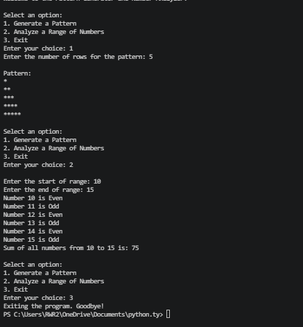

 #  Pattern Generator and Number Analyzer

##  Project Description

A Python-based menu-driven application that generates star patterns, identifies even and odd numbers, and calculates the sum of numbers within a given range.

###  Features

 Pattern Generation: Creates a right-angled triangle star pattern.

 Even and Odd Analysis: Identifies even and odd numbers in a given range.

 Sum Calculation: Calculates the sum of all numbers in the selected range.

 Error Handling: Displays error messages for invalid choices and ranges.

 Exit Option: Allows users to exit the program.

## 📸 Project Output

Here is the sample output of the program:

  
